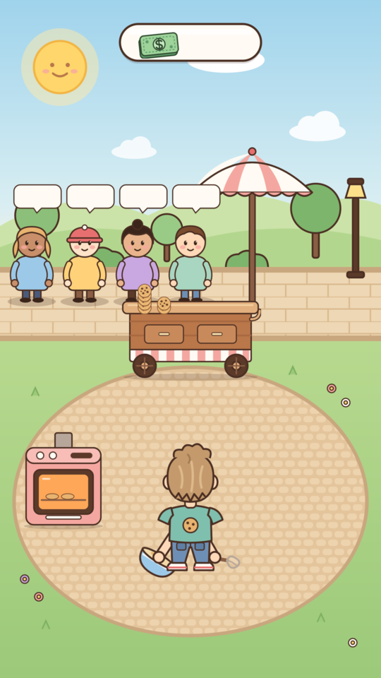
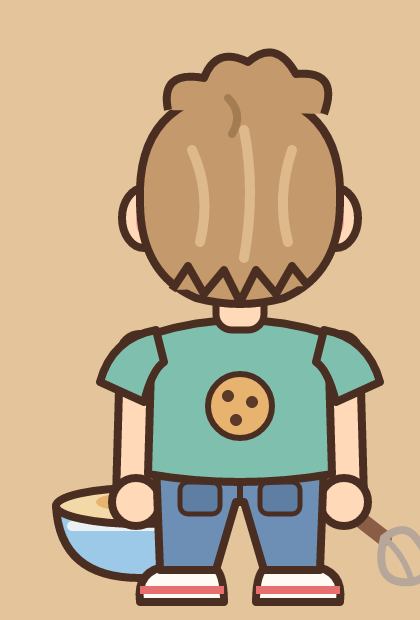
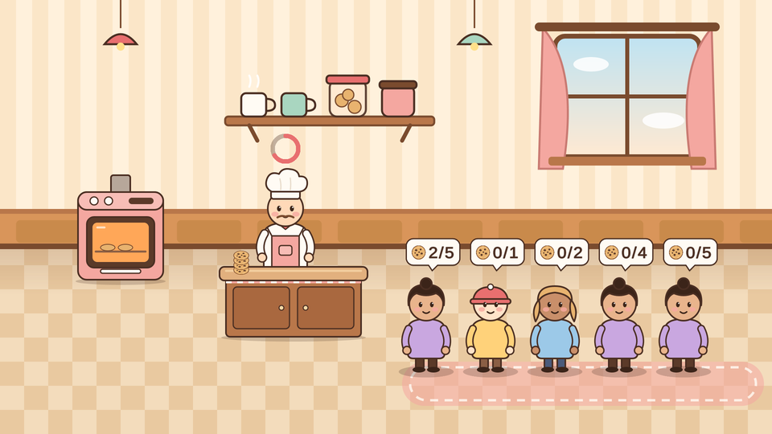
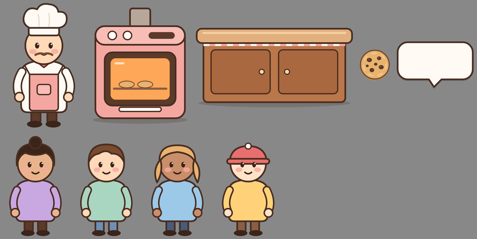

# Devlog

Progress notes for the cookie clicker, newest first. Screenshots live in `docs/devlog/`.

---

## 2026-11-08 · Tastier cookies

- Redrew the cookie: a warm golden dough gradient, a bumpy hand-made edge, glossy chocolate chunks, little baked cracks, crumbs and a sparkle.
- Same size and pivot as before, so it drops into the cart stacks, speech bubbles and existing layout without changes.

## 2026-11-08 · Upgrades

- Added an upgrade bar at the bottom: Bake Speed, Cookie Price, Tap Power and Customers.
- Each card shows the icon, level, current value and price. Cards fade out while you can't afford them.
- Prices grow 15% per level. All balancing lives in `Assets/Data/Upgrades`, see `docs/ECONOMY.md`.

## 2026-11-08 · Outdoor street vendor and money

*Layout mockup composed from the sprites outside Unity. An in-game capture comes with the next scene rebuild.*

- Moved the shop outdoors: a sunny park, a sidewalk for the customer line and a cookie cart with a striped umbrella.
- New vendor: a guy in his 20s with light brown hair and a t-shirt, seen from behind. His arms are separate sprites, so he can whisk while baking, cheer and hop when a cookie is done, and squash on every tap.
- Customers now walk in from the left and leave to the right.
- Every sold cookie earns money. A dollar bill with a "+n $" label pops up near the cart, then slides into the money counter at the top.
- Economy hooks for upgrades: `Wallet.TrySpend` and `CashRegister.PricePerCookie`.

## 2026-11-08 · Portrait mode and tap to bake

- Switched to portrait (1080x1920) and moved the baker to the bottom of the screen, facing the counter with his back to the player.
- Tapping anywhere fills the bake ring by 20% right away. Taps on UI elements will be ignored, so future upgrade buttons won't trigger it.

## 2026-11-08 · First playable loop

- Created the Unity 6 2D project and drew all art as SVGs in a coffee and cookie palette.
- A baker bakes cookies nonstop with a progress ring over his head and stacks them on the table up to a limit.
- Customers line up in a single queue, each with a speech bubble that counts up (1/5, 2/5...). A customer who gets every cookie walks away.
- The scene and prefabs are generated by editor scripts, and play mode tests cover the bake and serve loop.

