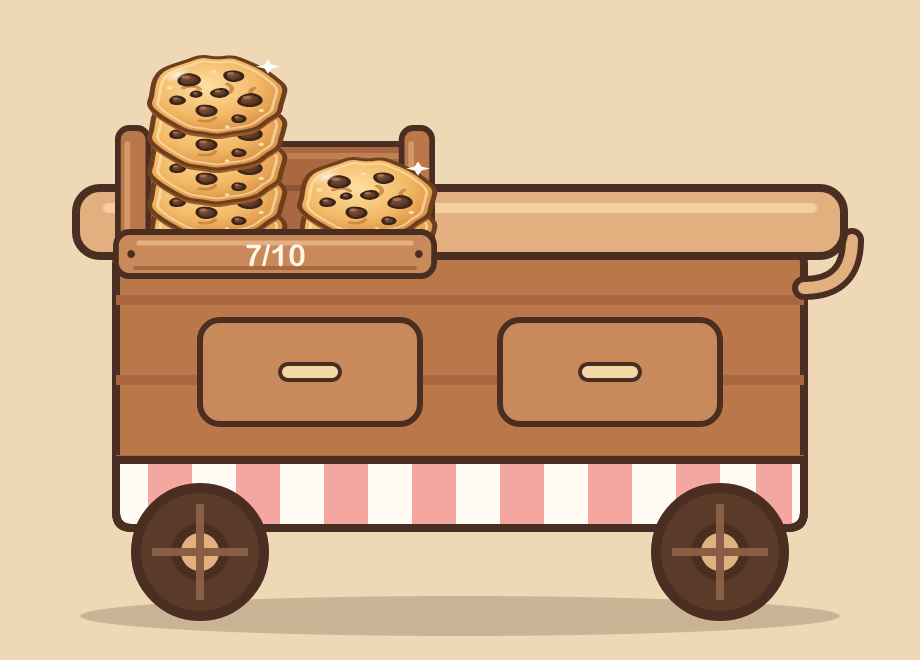
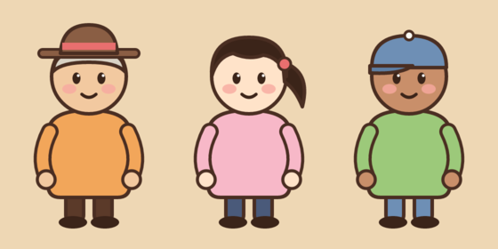
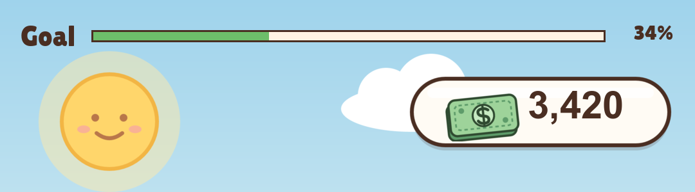
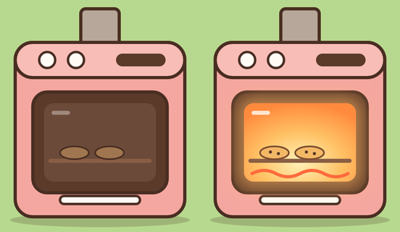
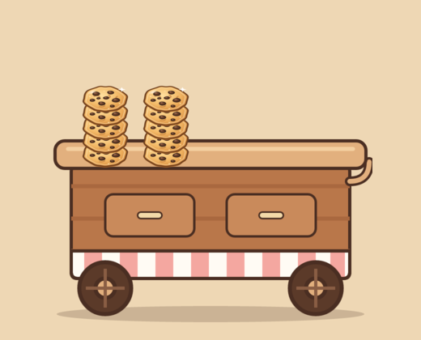

# Devlog

Progress notes for the cookie clicker, newest first. Screenshots live in `docs/devlog/`.

---

## 2026-11-13 · Cookie holder

*Composed outside Unity to check the fit.*

- Cookies now stack inside a small wooden holder on the cart. Its front board covers the bottom of the stacks and shows a minimal "count/capacity" label, like 7/10.
- The holder's boards are sliced sprites that stretch to fit every stack, so a future capacity upgrade only has to raise `CookieTable.Capacity`.
- The progress ring above the vendor's head hides while the cart is full and comes back as soon as a cookie is sold.
- Install with *Cookie Clicker → Install Missing Features*. Padding and floor height are on the `Cookie Holder View` component.

## 2026-11-13 · A livelier street

- People now walk along the street in front of the cart, in both directions, at random speeds. Three new looks (hat, ponytail, cap) mix with the existing ones.
- Only some of them stop to buy. New customers walk in along the street from either side, step into the line, and keep walking the way they came once served. Everyone else just passes by.
- Customers stand still for a moment with their cookies before walking off. The line moves up only once they leave.
- Slower start: a cookie takes 4 s (was 1.5 s) and a customer shows up about every 9 s (was 2.5 s). Bake Speed and Customers now improve 12% per level, so the stand gets busy through upgrades.
- Install with *Cookie Clicker → Install Missing Features*. The lane and pacing live on the new `Street` object, see `docs/ECONOMY.md`.

## 2026-11-08 · Goal bar

*Composed outside Unity to check the layout.*

- A thin, flat bar along the top fills green toward a big earnings goal (10,000 $ for now), with a "Goal" title in Lilita One and the percentage on the right. It sits inside the device's safe area, so notches don't cover it.
- It counts money earned from sales, so buying upgrades never moves it back. Progress is saved.
- When it fills up, `LevelGoal.Completed` fires once. Moving on to the next level will hook in there later.

## 2026-11-08 · Glowing oven

- The oven is now two layers: a dark idle oven and a warm glow (window light, halo, red-hot element, golden cookies).
- While the vendor bakes, the glow fades in and flickers softly. It flashes brighter each time a cookie is done and fades out when baking stops, for example when the cart is full.
- New features are added to the existing scene with one menu item: *Cookie Clicker → Install Missing Features*.

## 2026-11-08 · Save system

- The game now remembers money, upgrade levels, cookies on the cart and the current bake progress between sessions. Customers in line are not saved; a fresh line forms on launch.
- Saves go to `Application.persistentDataPath` as JSON with a version number. Each write goes to a temp file first and the previous save is kept as a backup, so a crash or a killed app can't leave a broken save.
- Saves happen every 10 seconds, when the app goes to the background (the moment Android and iOS may kill it) and on quit.
- New editor window *Cookie Clicker → Game Data* shows what is saved and has a reset button.

## 2026-11-08 · Bigger cookie stacks

*Composed outside Unity to check the fit.*

- Cookies stacked on the cart are about 55% bigger, with wider spacing between stacks.
- Stack size, spacing, height and flatness are on the `Cookie Stack View` component, and changes made there while the game runs show up live.

## 2026-11-08 · Whole orders in one go

- When a customer reaches the cart, they take their entire order at once if enough cookies are ready, and pay the total in a single "+n $" popup.
- If the cart is short, they grab what is there and pick up the rest as fresh cookies come out of the oven.

## 2026-11-08 · Tastier cookies

- Redrew the cookie: a warm golden dough gradient, a bumpy hand-made edge, glossy chocolate chunks, little baked cracks, crumbs and a sparkle.
- Same size and pivot as before, so it drops into the cart stacks, speech bubbles and existing layout without changes.

## 2026-11-08 · Upgrades

- Added an upgrade bar at the bottom: Bake Speed, Cookie Price, Tap Power and Customers.
- Each card shows the icon, level, current value and price. Cards fade out while you can't afford them.
- Prices grow 15% per level. All balancing lives in `Assets/Data/Upgrades`, see `docs/ECONOMY.md`.

## 2026-11-08 · Outdoor street vendor and money

*Layout mockup composed from the sprites outside Unity. An in-game capture comes with the next scene rebuild.*

- Moved the shop outdoors: a sunny park, a sidewalk for the customer line and a cookie cart with a striped umbrella.
- New vendor: a guy in his 20s with light brown hair and a t-shirt, seen from behind. His arms are separate sprites, so he can whisk while baking, cheer and hop when a cookie is done, and squash on every tap.
- Customers now walk in from the left and leave to the right.
- Every sold cookie earns money. A dollar bill with a "+n $" label pops up near the cart, then slides into the money counter at the top.
- Economy hooks for upgrades: `Wallet.TrySpend` and `CashRegister.PricePerCookie`.

## 2026-11-08 · Portrait mode and tap to bake

- Switched to portrait (1080x1920) and moved the baker to the bottom of the screen, facing the counter with his back to the player.
- Tapping anywhere fills the bake ring by 20% right away. Taps on UI elements will be ignored, so future upgrade buttons won't trigger it.

## 2026-11-08 · First playable loop

- Created the Unity 6 2D project and drew all art as SVGs in a coffee and cookie palette.
- A baker bakes cookies nonstop with a progress ring over his head and stacks them on the table up to a limit.
- Customers line up in a single queue, each with a speech bubble that counts up (1/5, 2/5...). A customer who gets every cookie walks away.
- The scene and prefabs are generated by editor scripts, and play mode tests cover the bake and serve loop.

